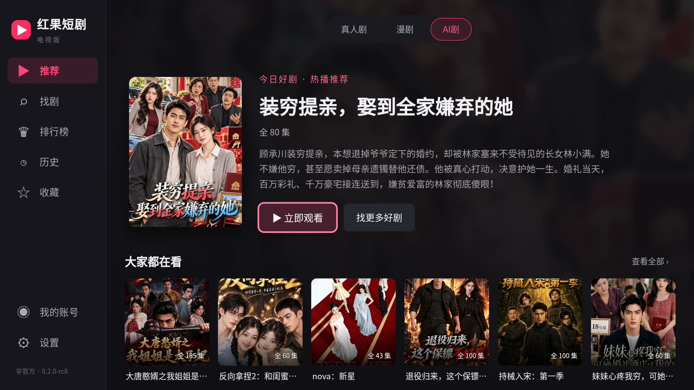
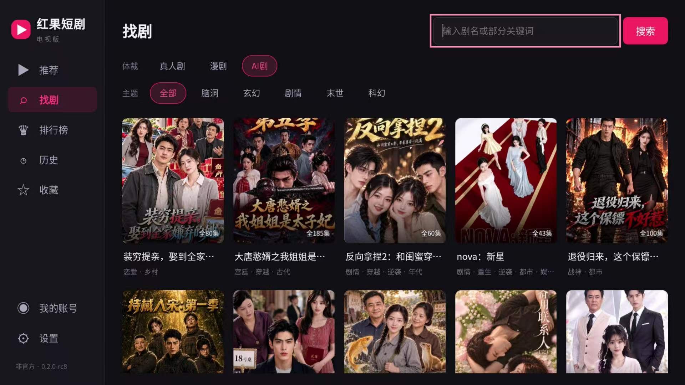
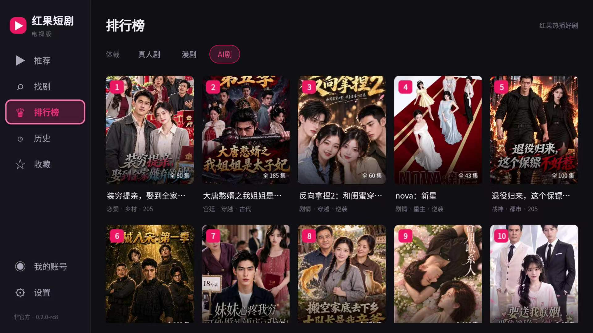
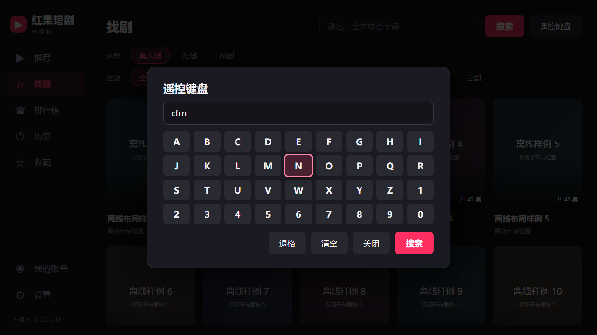
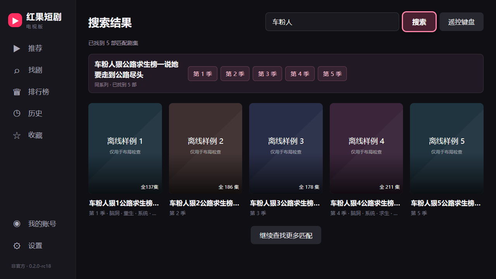

# 红果短剧电视版

### 用电视遥控器找剧，坐在沙发上接着看

适用于 Android 电视和盒子的非官方客户端。最低支持 **Android 6.0（API 23）**。

**分类找剧 · 拼音搜索 · 自动连播 · 收藏续看 · 弹幕和评论**

**[⬇️ 下载 Android TV APK](https://github.com/henson957/Hongguo-player-TV/releases/download/v0.2.0-rc18/Hongguo-TV-0.2.0-rc18-Android6.apk)**　·　[查看版本说明](https://github.com/henson957/Hongguo-player-TV/releases/tag/v0.2.0-rc18)

## 为什么做电视版？

这个项目最初是给雷鸟雀 4 做的。想在客厅看短剧时，拿起遥控器，打开电视上的应用就能看。上次看到哪一集，下次也能接着看。

## 主要功能

- **分类与排行榜**　按真人剧、漫剧和 AI 剧浏览，也可以按题材筛选。「找剧」和「排行榜」接近底部时自动加载下一页，焦点留在当前卡片。
- **遥控器拼音搜索**　输入中文剧名、全拼或首字母。比如《爱情公寓》可以搜 **aiqinggongyu** 或 **aqgy**。搜索结果会集中展示匹配到的同系列分季。
- **自动连播与续看**　播放时提前准备下一集，记住上次看到哪一集、哪个位置。支持 1×、1.5× 和 2× 倍速。
- **清晰度选择**　默认自动选择可播放的清晰度，也可以手动选择 1080P、720P 或 480P。
- **弹幕和评论**　播放时可以调整弹幕显示和字号，也可以查看评论。
- **收藏和历史**　可以先用本机记录。在「我的账号」扫码或短信登录后，可开启收藏和观看记录的自动合并。

## 界面预览

点击图片可查看原图。

| 找剧 | 排行榜 |
| --- | --- |
|  |  |
| **遥控键盘** | **同系列搜索结果** |
|  |  |

首页、找剧和排行榜为早期版本录制。遥控键盘和搜索结果为 rc18 界面测试截图，使用了示例封面。另见[剧集详情与选集](docs/screenshots/episode-picker.png)。

## 下载与安装

| 设备 | 系统要求 | 安装包 |
| --- | --- | --- |
| Android 电视 / 盒子 | Android 6.0（API 23）及以上 | [0.2.0-rc18 APK](https://github.com/henson957/Hongguo-player-TV/releases/download/v0.2.0-rc18/Hongguo-TV-0.2.0-rc18-Android6.apk) |

1. 下载后缀为 **.apk** 的安装包。[Releases](https://github.com/henson957/Hongguo-player-TV/releases/tag/v0.2.0-rc18) 提供版本说明和 APK 的 SHA-256 校验值。
2. 用 U 盘把 APK 拷到电视，或者用电视支持的文件传输工具发送，然后在电视上打开 APK 安装。部分电视需要在系统设置中允许对应文件管理器安装应用。
3. 从电视应用列表打开「红果电视·测试」。已安装本项目同签名的旧版可以直接覆盖升级。

## 遥控器怎么用？

| 场景 | 操作 |
| --- | --- |
| 浏览页面 | 方向键移动焦点，确认键打开，返回键关闭弹窗或返回首页 |
| 找剧 | 打开「遥控键盘」，用方向键选字母，确认后选择「搜索」 |
| 播放 | 确认键播放或暂停，左右键快退或快进 10 秒 |
| 播放控制 | 菜单键或上下键呼出控制栏，可选集、调清晰度和倍速 |

## 常见问题

<strong>用手机推送安装包失败怎么办？</strong>

如果用当贝助手、野草助手等从手机推送 APK 失败，或提示「数据包异常」「解析错误」，**建议优先用 U 盘安装**。把下载好的 `.apk` 文件复制到 U 盘，插入电视后，在电视的文件管理器里打开 APK 安装。

<strong>安装时提示 INSTALL_FAILED_OLDER_SDK？</strong>

这个错误表示电视的 Android 系统低于安装包要求。可在电视的「关于」或「设备信息」里查看系统版本。rc13 最低需要 Android 8.0，rc18 最低需要 Android 6.0。

<strong>第一次能打开，第二次黑屏？</strong>

rc18 加了界面恢复处理。启动或回到前台时，如果界面无法恢复，会尝试重新打开界面。出现「重试打开」时，可以用遥控器选中重试。这个问题仍需在反馈设备上验证。

如果仍然黑屏，请附上电视型号、Android 版本，并注明是按「主页」回桌面后再次打开，还是按「返回」退出后再次打开。

<strong>个别剧集播不了，或者一直缓冲？</strong>

可在播放控制栏里试一下 720P 或 480P。反馈时请写上剧名、集数和错误提示，方便区分片源、网络和设备解码问题。

<strong>必须登录吗？</strong>

浏览和搜索可以直接使用，未登录时收藏和观看历史保存在电视上。需要合并账号记录时，打开「我的账号」登录并检查自动合并状态。

## 问题反馈

遇到问题请到 [GitHub Issues](https://github.com/henson957/Hongguo-player-TV/issues) 反馈。附上应用版本、电视型号、Android 版本和复现步骤。有截图时请遮住手机号、登录二维码和红果号。

## ⚠️ 说明

本项目是个人开发的 **非官方** Android 电视客户端，与红果短剧官方无关。安装包免费分享，供个人学习和交流。

## 👤 联系作者

- GitHub 维护者 [@henson957](https://github.com/henson957)
- 问题反馈与功能建议 [GitHub Issues](https://github.com/henson957/Hongguo-player-TV/issues)

## ⭐ 如果对你有帮助

如果电视版用着顺手，欢迎给仓库点个 Star，也欢迎分享给身边爱看短剧的朋友。
